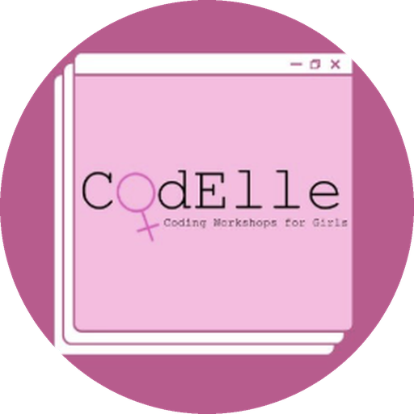

<p align="center">
  
</p>

# CodElle Website

The website of **CodElle**, a student association at Concordia University that runs coding workshops for girls ([@codelleworkshops](https://www.instagram.com/codelleworkshops/)).

The site is built by our members during a React & TypeScript workshop. Once finished, it also serves as a portfolio piece for our sponsorship team: it shows companies what CodElle members can build, and invites them to partner with us.

| Part | Tech | Folder |
|------|------|--------|
| Frontend | React, TypeScript, Vite | `client/` |
| Backend | Node.js, Express, TypeScript | `server/` |
| Shared types | TypeScript | `shared/types.ts` |

Contact: [codelleconcordia@gmail.com](mailto:codelleconcordia@gmail.com)

---

## Setup

### 1. Install the tools (one time only)

| Tool | Download | Check it works |
|------|----------|----------------|
| Node.js, v18 or newer (pick "LTS") | https://nodejs.org | `node -v` |
| Git | https://git-scm.com/downloads | `git --version` |
| VS Code | https://code.visualstudio.com | |

To open a terminal in VS Code, use the menu **Terminal → New Terminal**.

### 2. Download the project

```bash
git clone https://github.com/CodElleWorkshops/CodElle_Website.git
cd CodElle_Website
```

No Git? On the GitHub page, click **Code → Download ZIP**, unzip it, and open the folder in VS Code.

### 3. Install the packages

From the main `CodElle_Website` folder:

```bash
npm install
```

This installs everything for both the client and the server. It can take a minute.

### 4. Start the website

```bash
npm run dev
```

This starts two things at once:

| | URL | What it is |
|---|---|---|
| Website | http://localhost:5173 | The React site. Open this one. |
| API | http://localhost:4000/api/health | The TypeScript backend |

To stop it, click in the terminal and press **Ctrl + C**.

---

## The workshop

Open http://localhost:5173/workshop (also linked in the footer) to see the mission map. Each mission is one page of the site:

| # | Page | File you edit | Guide | Concepts |
|---|------|---------------|-------|----------|
| 0 | Home (already done) | `client/src/pages/HomePage.tsx` | read it as an example | JSX, components, props |
| 1 | About | `client/src/pages/AboutPage.tsx` | [01-about-page.md](docs/workshop/01-about-page.md) | Interfaces, props, `.map()` |
| 2 | Team | `client/src/pages/TeamPage.tsx` | [02-team-page.md](docs/workshop/02-team-page.md) | Lists, keys, optional fields |
| 3 | Events | `client/src/pages/EventsPage.tsx` | [03-events-page.md](docs/workshop/03-events-page.md) | `useState`, `useEffect`, `fetch` |
| 4 | Contact | `client/src/pages/ContactPage.tsx` | [04-contact-page.md](docs/workshop/04-contact-page.md) | Forms, events, POST requests |
| + | Bonus | `server/src/routes/` | [05-bonus-backend.md](docs/workshop/05-bonus-backend.md) | Express routes |

Each page file starts with an "under construction" placeholder and numbered steps in a comment at the top. Follow the guide, save, and the browser updates.

The **Partners** page (`client/src/pages/PartnersPage.tsx`) is already finished, so the site can be shown to companies at any time.

**Stuck?** Every mission has a finished version in `client/src/solutions/`. To show one in the browser, set it to `true` in `client/src/workshop.ts`:

```ts
export const showSolution = { about: true, team: false, events: false, contact: false };
```

Leading the workshop? Read the [Instructor Guide](docs/workshop/00-instructor-guide.md).

---

## Project structure

```
CodElle_Website/
├── client/                    React frontend
│   ├── public/logo.png        the CodElle logo
│   └── src/
│       ├── pages/             the pages you build in the workshop
│       ├── solutions/         finished versions of each mission
│       ├── components/        Navbar, Footer, Window (the logo-style card)
│       ├── data/              site text: about, team, partners
│       ├── api/client.ts      functions that talk to the backend
│       ├── styles/global.css  theme (logo colours are at the top)
│       ├── workshop.ts        solution on/off switches
│       └── App.tsx            routes: which URL shows which page
├── server/                    TypeScript backend
│   └── src/
│       ├── index.ts           starts the Express server
│       ├── routes/            /api/events and /api/contact
│       └── data/events.ts     the list of events
├── shared/types.ts            types shared by client and server
└── docs/workshop/             step-by-step mission guides
```

## API

| Method | URL | Description |
|--------|-----|-------------|
| GET | `/api/health` | Check the server is running |
| GET | `/api/events` | All events. Add `?category=workshop` to filter |
| GET | `/api/events/:id` | One event |
| POST | `/api/contact` | Send a message: `{ name, email, organization?, message }` |
| GET | `/api/contact` | Messages received so far (kept in memory) |

## Commands

Run these from the main folder:

| Command | What it does |
|---------|--------------|
| `npm run dev` | Start the website and the server |
| `npm run typecheck` | Check every file for TypeScript errors |
| `npm run build` | Build a production version |

## Updating the content

All the text lives in small data files, so there's no need to dig through the code:

- `client/src/data/site.ts`: name, tagline, intro, email, Instagram
- `client/src/data/about.ts`: mission and values
- `client/src/data/team.ts`: executive team
- `client/src/data/partners.ts`: sponsorship offers and current partners
- `server/src/data/events.ts`: events
